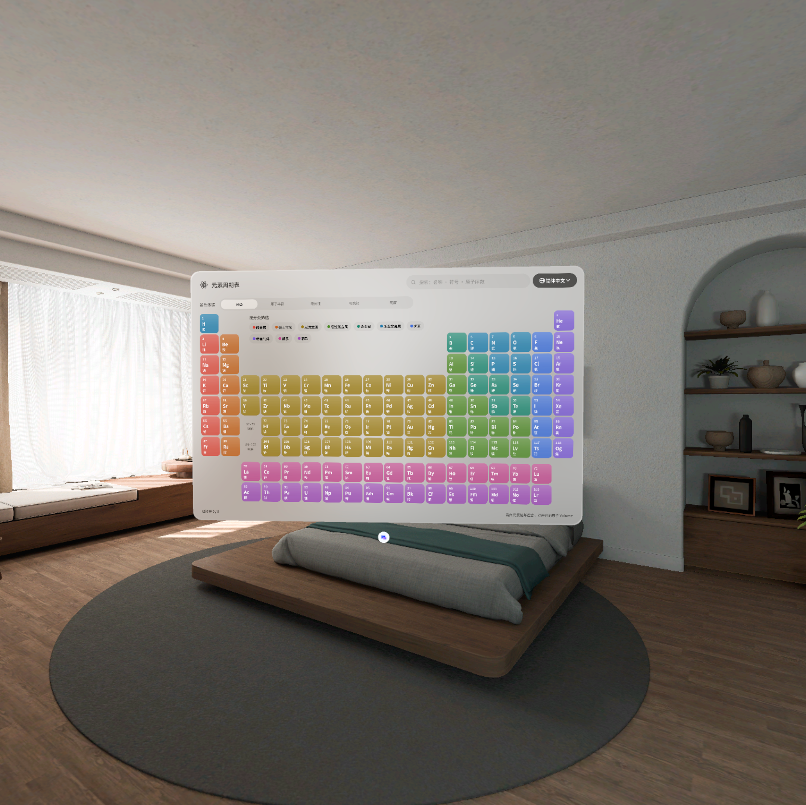

# Element Space

A spatial periodic table for PICO OS 6. The table floats in your room as a glass window;
tap any element and its atom opens beside it as a rotatable 3D model in its own Volume:
electron shells, a packed nucleus, the electron cloud, and the crystal or molecular
structures of its allotropes.

Built with the PICO Spatial SDK (Kotlin, Jetpack Compose, SpatialUI, Spatial ECS) for
self-study: everything is explorable by hand, eye or controller, with no voice-over and
no course to follow.



## What it does

**Periodic table window** (Planar, 1360 × 880 dp)

- All 118 elements in the 18-column layout, tinted by category, with the lanthanides and
  actinides below.
- Hover any tile and it swells and floats toward you; open elements stay lifted.
- Search by name, symbol or atomic number; filter by category with the chips in the empty
  block above the transition metals.
- *Colour by* switches the tint between category and four trends (atomic radius,
  electronegativity, first ionisation energy, density); in a trend, tiles rise with their value.
- UI language switch (Simplified Chinese and English today; adding a language is one
  `values-xx` folder plus an enum entry).

**Atom Volume** (Volumetric, 1600 dp cube, up to three open at once)

| View | What you see |
| --- | --- |
| Shells | Bohr model: orbit rings with electrons as small metallic beads, the nucleus at the centre |
| Nucleus | Protons and neutrons packed into a sphere, with the mass number worked out beside it |
| Cloud *(advanced)* | A point cloud sampled from real s / p / d / f orbital shapes; each subshell can be switched on and off |
| Allotropes *(advanced)* | Diamond, graphite, C₆₀, O₂ / O₃, S₈, P₄ and the bcc / fcc / hcp metal lattices |

- Pinch and drag to rotate, two hands to scale; pause and reset from the toolbar.
- An info card beside the model shows composition, electron shells, isotopes (switch
  isotope to change the neutron count) and reference properties. The advanced entry adds the
  electron configuration and an ion charge stepper.

Advanced features sit one tap away so the default screen is readable at any age.

## Design

- **Cloud Crystal**: windows, toolbar and info card use the system's light-adaptive glass;
  element tiles are translucent crystal blocks with a top sheen.
- All 2D UI is SpatialUI inside `PicoTheme`; no Material components.
- Typography is Noto Sans (English) and Noto Sans SC (Chinese), bundled as variable fonts
  under the SIL Open Font License (see `app/src/main/assets/fonts`).
- Product spec and Figma frames were produced first and the app was written from them.

## Project layout

```
app/src/main/java/com/example/elementspace/p7c3a91e4/
  data/repository/   bundled element dataset, session state (language, open Volumes)
  domain/model/      Element, Isotope, Allotrope, ElectronConfiguration, scene geometry
  domain/usecase/    filtering, electron configuration, trend scaling, nucleus packing,
                     orbital-cloud sampling, allotrope lattices  (pure Kotlin, unit-tested)
  ui/table/          periodic table screen: UiState, ViewModel, components
  ui/atom/           atom Volume: UiState, ViewModel, ECS scene, toolbar, info card
  ui/theme/          colours, Noto typography, in-app localisation
app/src/test/       JUnit tests for the domain, repositories and ViewModels
```

The 3D model is an ECS entity tree (`ui/atom/components/AtomScene.kt`): instanced meshes
for electrons, nucleons, cloud points and lattice atoms, with orbit motion driven by a
custom `System` rather than by recomposition.

## Building and running

Requirements: Android Studio (JDK 17 bundled), the PICO Spatial SDK 6.1 toolchain and
[`pico-cli`](https://developer.picoxr.com/) for the emulator.

```bash
./gradlew :app:assembleDebug
./gradlew :app:testDebugUnitTest
```

Run on the PICO emulator:

```bash
pico-cli emulator start
pico-cli app install app/build/outputs/apk/debug/app-debug.apk
pico-cli app launch com.example.elementspace.p7c3a91e4 --activity .platform.LaunchActivity
```

## Status and caveats

- Verified on the PICO emulator 6.1. Not yet run on a headset, so frame rate and eye, hand
  and controller input are untested there.
- The element dataset (masses, radii, electronegativities, ionisation energies, densities,
  isotopes) was typed in for the first build and still needs checking against a reference
  source before being trusted for study.
- Models are teaching pictures, not measurements: the nucleus is drawn about 10⁴ times too
  large relative to the shells, electrons have no real size or colour, and orbit rings are the
  Bohr simplification.
- Trend mode lifts tiles rather than drawing solid pillars.

See `AGENTS.md` for the architecture rules and the lessons learned while building the app.
